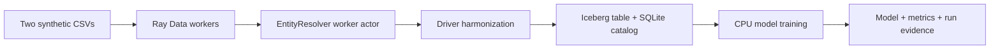

# Ray AI Platform assignment

Local-first implementation for the DevOps take-home assignment, validated on EKS,
S3, Glue and IRSA in Singapore with a total cloud spending target of $30. OIDC CI/CD is implemented;
observability and the remaining submission work are listed below.

Verified: 19 correctness/configuration/cleanup/CI safety tests, native Ray execution and idempotent rerun,
ARM64 image build, and a successful Kubernetes RayJob with dedicated actor
placement. Three AWS runs also verify S3/Glue persistence, scoped IRSA, unchanged
Iceberg snapshots on repeat, and worker scale-down/cold start from zero.
See `docs/aws-validation.md`, `docs/validation.md`
and `docs/evidence/` for results; deployment instructions are in `infra/README.md`.

## Quick start

Requires Docker Desktop, Python 3.11, kind, kubectl, Helm, and make. On the verified
16 GB ARM64 Mac, Docker has 6 CPUs and about 8 GB RAM. Close heavy applications
while running Kubernetes. No GPU, LLM API subscription, or AWS credentials needed.

```sh
bash scripts/install-kubectl.sh  # checksum-verified, project-local 1.34.3
export PATH="$PWD/.tools:$PATH"
make preflight
make setup
make test
make run          # native Mac Ray smoke test; writes runtime/run.json
make image-offline # tested path on this Mac; caches Linux wheels on the host
make local-up     # creates only the named local kind cluster
make submit
make status
```

All Kubernetes commands explicitly use `kind-ray-assignment`. The setup uses two
kind nodes: system/head on the control-plane node and Ray workers on the worker
node. The resolver requires the Ray custom resource `entity_resolver`, advertised
only by the worker. The head exposes zero Ray task CPUs. RayJob creates a cluster
per run and removes it five minutes after completion; submit only one job at a time.

```sh
kubectl --context kind-ray-assignment -n ray-assignment get rayjobs
kubectl --context kind-ray-assignment -n ray-assignment logs -l ray.io/node-type=head --all-containers=true
# While a job's head is running, select its service from:
kubectl --context kind-ray-assignment -n ray-assignment get services
# Then use: kubectl ... port-forward service/<head-service> 8265:8265
```

Keep the dashboard on localhost. KubeRay generates a per-cluster authentication
token in a Kubernetes Secret; do not commit or print the token in evidence. This
development cluster must not be exposed on a public network. Outputs survive cluster deletion in
`runtime/kubernetes/`: catalog.db, warehouse/, model/model.joblib,
model/metrics.json, and run.json. For a second run use `make submit` after the first
job completes; the second commit should insert and update zero rows.

If Docker VM downloads are slow, use `make image-offline` instead of `make image`.
It downloads Linux wheels on the host and installs them offline in the image.
The `.wheelhouse` cache is ignored by Git and scoped to the Docker architecture.

```sh
make local-down  # removes only the ray-assignment cluster; preserves outputs
```

## Data and correctness

Two deterministic CSVs contain 1,200 companies each, with 600 overlapping
companies and different name suffixes. Expected result: 1,800 canonical companies.
The identity key is country plus normalized registration ID, hashed with SHA-256.
Company names are display fields, not identity keys. Missing identifiers fail
validation rather than silently merging unrelated firms. Financial-source records
take precedence over supply-source records. Inputs must contain one record per
company per source; within-source conflict resolution is outside this fixture.

Ray Data reads both files; a resource-constrained Ray actor resolves identity.
The driver harmonizes records and upserts an Iceberg table using its canonical ID.
Training reads back the committed table. The baseline is a deterministic CPU
RandomForest with an 80/20 company-level holdout; revenue is excluded from features.
Metrics include MAE in USD, R² and a sample prediction. Synthetic-data accuracy is
only a functional test, not evidence of real-world prediction quality.

## Local architecture and limits



- Local catalog: SQLite with a single driver writer and a local filesystem
  warehouse. Only the head mounts it. This deliberately does not claim distributed
  storage, HA, concurrent writer support, or AWS identity validation.
- The local bind mount is writable by the non-root pod user and contains only
  synthetic data. Do not use this hostPath/permission profile in AWS.
- Data collection is capped at 100,000 rows. This small-data implementation is not
  a scalable distributed join. Training currently uses sklearn in the driver,
  not distributed Ray Train; Ray Train configuration remains a subsequent milestone.
- Head object store: 256 MiB inside 384 MiB shared memory; worker: 384 MiB inside
  512 MiB shared memory. Both pods have 2 GiB memory limits. Shared memory counts
  toward pod memory limits. A 1.5 GiB head limit caused a Ray memory-monitor failure
  during a fresh-cluster rerun, so the head limit was raised rather than disabling
  the memory monitor.
- Local worker count is fixed at one. AWS Terraform and S3/Glue/IRSA support are
  implemented separately; see `infra/README.md` for deployment and teardown.
  CI/CD uses GitHub OIDC and private CodeBuild jobs; see `docs/cicd.md`.
  Central logs, Prometheus and a cloud Spot recovery test remain pending.
- Image tags and direct dependencies are pinned. Transitive environment lock files
  are recorded after successful installation; cross-platform dependencies can differ.

## Next milestones

1. Integrate distributed Ray Train and capture a Spot interruption/recovery test.
2. Add Prometheus, centralized logs, failure/recovery evidence and a serverless
   alternative discussion. Capture the AWS demo and tear down before submission.

See `docs/prerequisites.md` for the inspected machine and validation status.
