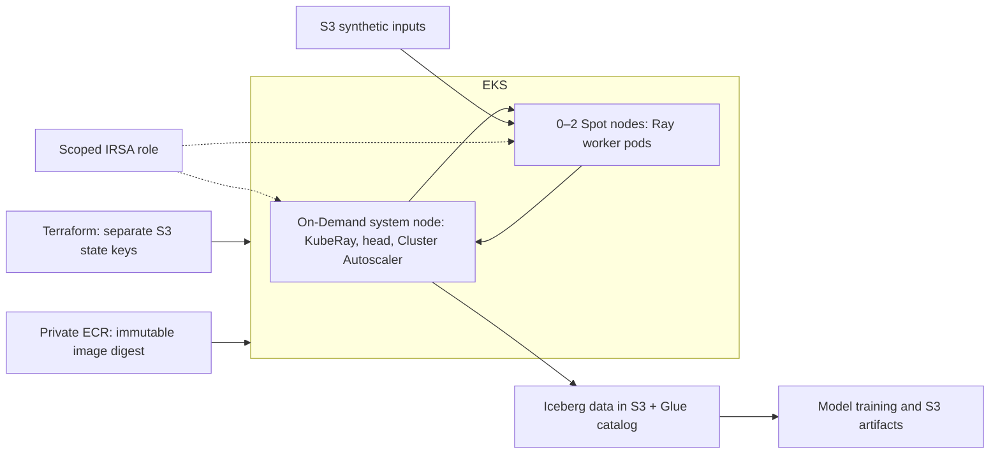

# AWS validation — October 24, 2026

Region: Singapore (`ap-southeast-1`). CLI profile: `ray-assignment-role`.
Provisioning uses the configured owner role; application pods use the separate
`ray-assignment-pipeline` role through IRSA. No static AWS credentials are embedded
in images or Kubernetes manifests.

## Deployed architecture

Nodes use private subnets, encrypted gp3 volumes and IMDSv2. The Kubernetes public
API is restricted to the administrator's `/32`; Ray has no public load balancer.
A single NAT and S3 gateway endpoint provide outbound access. One system node
and one NAT are deliberate demonstration compromises, not production HA.

## Executed evidence

| Check | Observed result |
|---|---|
| Terraform | Bootstrap, data, compute, platform applied; compute/platform follow-up plans show no changes |
| Kubernetes | Both ARM64 EKS nodes Ready; system On-Demand, worker Spot |
| Pipeline | 2,400 S3 input rows -> 1,800 canonical companies |
| First Iceberg transaction | 1,800 inserted, zero updated |
| Fresh-cluster repeat | Zero inserted/updated; snapshot unchanged |
| Cold start | Idle worker pool scaled to zero; pending Ray pod triggered 0 -> 1, then desired capacity reached 2; third job succeeded with unchanged snapshot |
| Model | 1,440 training / 360 test rows; R² 0.98364 on synthetic data |
| IRSA | Both driver and resolver report `assumed-role/ray-assignment-pipeline/...` |
| Access boundary | Pod reads input CSV; reading the state-bucket backup returns 403 |
| Budget | $30 gross monthly budget, credits excluded; $10/$20/$25 email subscriptions verified |
| Cleanup guard | Live invocation returns `within-lease`; expiry `2026-10-24T17:40:01Z` |
| Local checks | 13 tests pass; all four Terraform stacks validate |

The public evidence is `docs/evidence/cloud-validation-summary.json`. Raw reports
and deployment identifiers remain in ignored local `docs/evidence/aws-*.json`
files and the private S3 data bucket. The deployment uses an immutable ECR digest.

## Issues resolved during validation

1. An inherited MinIO endpoint redirected the initial S3 request. The assignment
   environment helper clears endpoint overrides before using AWS. Other profiles
   remain intact.
2. EKS control-plane creation succeeded on the Free plan, but EC2 rejected the
   selected node types. The previously authorized Paid upgrade resolved this;
   both node groups then joined successfully.
3. The default submitter requested 500m CPU and could not fit on the system node.
   The AWS renderer requests 100m with a 500m limit; both successful runs use this
   configuration without adding a node.
4. During cold start, AWS availability-zone balancing temporarily launched three
   Spot instances while desired/max capacity were two, then terminated the excess
   instance. The configured maximum is a steady-state capacity limit, not a strict
   instantaneous instance count. The demonstration allowance includes headroom
   for this overlap. Scale-down and cold-start events are retained as evidence.

## Remaining assignment work

CI/CD with OIDC, Prometheus/dashboard and centralized workload logs, a deliberate
Spot interruption/recovery test, distributed Ray Train integration, and the
serverless alternative write-up remain separate milestones. This document proves
the AWS storage/catalog/identity and pipeline path, not completion of those items.

The active compute lease expires at **11:10 PM IST on October 24**. Cleanup starts
on the following 15-minute schedule tick and is asynchronous. Use normal Terraform
teardown in `infra/README.md` when finished; budget notifications and the lease
guard do not provide a hard dollar cap. See `docs/aws-cost-plan.md` for estimates.
