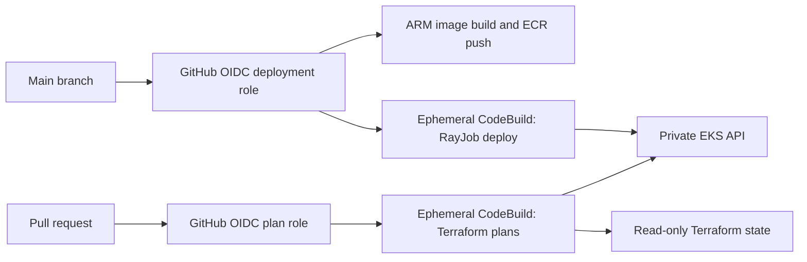

# GitHub Actions delivery

Repository: https://github.com/SumitSharma-DevOps-3107/contexq-assignment

## Workflows

`Terraform plans and tests` runs on pull requests and can be dispatched from
`main`. Every PR gets tests, formatting and backend-free validation. Same-repository
PRs additionally run live plans for bootstrap, data, compute, ci and platform.
Fork PRs receive no AWS credentials. There is no `pull_request_target` workflow.

`Build image and deploy RayJob` runs on pushes/merges to `main` and manual dispatch
from `main`. It tests the application, builds Linux ARM64 on a GitHub-hosted ARM
runner, pushes a unique immutable ECR tag, then deploys the resulting digest.
Both workflows pin external Actions to full commit hashes.

## Identity and network path



GitHub's issuer is trusted only for this exact repository, with audience
`sts.amazonaws.com`. The plan role accepts PR subjects and `main` for manual
validation. The release role accepts only `refs/heads/main`. No long-lived AWS
keys are stored in GitHub. Protect `main` against unreviewed workflow changes.
The trust prefix is read from the repository's OIDC API, including immutable owner
and repository IDs when GitHub enables them. It is not guessed from the URL.

The existing EKS public allowlist is unchanged. CodeBuild starts small ARM
containers inside the existing private subnets, with no inbound access, no
privileged Docker daemon, and HTTPS egress through the existing NAT. It uses two
separate service roles: infrastructure reads plus necessary build-runtime
permissions for plans, and namespace-scoped RayJob submission for deployments.
Neither role can apply Terraform or change IAM, node groups, or the compute lease.
The planner can read Helm release Secrets only in the assignment namespace, as
required to refresh the Helm release; deployment cannot read Kubernetes Secrets.

Source ZIPs use immutable S3 version IDs. Detailed plans remain in the private CI
bucket; only status summaries are uploaded to the public GitHub repository. State
files, binary plan files, credentials, private configuration and budget email are
never included in the source archive or GitHub artifacts.

## Budget and failure behavior

- Both stages check the existing $30 gross budget (credits/refunds excluded).
  They refuse to start at $20 posted spend, or if spending data is unavailable.
- At least 30 minutes must remain on the existing compute lease. CI cannot renew
  it or create a cluster. An expired environment must be reviewed and provisioned
  by the owner before CI can resume.
- One build per CodeBuild project at a time. Plan timeout: 10 minutes; deployment:
  20 minutes; queue timeout: 5 minutes. GitHub serializes releases.
- A RayJob has a 15-minute active deadline, no CI retry, and a maximum of two Ray
  worker pods. Deployment waits for success and removes its RayJob on completion
  or failure. Cancellation stops CodeBuild; if cancellation interrupts cleanup,
  the RayJob deadline/TTL and compute lease remain the fallback.
- S3 source/results expire after one day; old versions after seven days.
  CloudWatch logs expire after three days. ECR retains the newest three images.
- Use a **$2 allowance for initial CI validation**, within the original $30 total.
  CodeBuild is billed only while builds run; GitHub public standard runners add no
  AWS compute bill. NAT download/transfer and residual storage still cost money.
  AWS billing is delayed: the budget check is a guardrail, not a hard dollar cap.

## One-time owner setup

1. Configure the working AWS profile and generate the local Terraform settings
   as described in `infra/README.md`. Keep the original lease deadline.
2. Apply compute's new VPC/subnet/security-group outputs, then apply platform's
   `ci-rbac.tf`. These preserve the original API allowlist.
3. Configure `infra/ci/terraform.tfvars.json` with `region`, `expected_account_id`,
   `state_bucket`, exact `github_repository`, and `github_oidc_subject_prefix` from
   `gh api repos/<owner>/<repository>/actions/oidc/customization/sub`.
   Preserve `sub_claim_prefix` exactly, including immutable IDs. Its backend key is
   `ci/terraform.tfstate`. Init, review the plan, then apply it. If the account
   already has GitHub's IAM OIDC provider, import that provider rather than
   creating a duplicate.
4. Sign into `gh` with repository and workflow scopes. Run:

   ```sh
   source scripts/aws-env.sh
   .venv/bin/python scripts/ci-configure.py
   ```

   This publishes settings to the private CI bucket and configures repository
   variables: `AWS_ACCOUNT_ID`, `AWS_REGION`, `AWS_CI_BUCKET`, `AWS_PLAN_ROLE_ARN`,
   `AWS_DEPLOY_ROLE_ARN`, `AWS_PLAN_PROJECT`, `AWS_DEPLOY_PROJECT`, and
   `ECR_REPOSITORY_URI`. These are identifiers, not secret keys.
5. Push the reviewed repository and set repository variable `CICD_ENABLED=true`.
   Dispatch the plan workflow first, then deployment. Leaving this variable
   absent/false disables cloud execution while local PR validation still runs.

After any owner-approved lease or infrastructure reconfiguration, rerun
`ci-configure.py` to synchronize the private settings. It does not renew the lease.
Do not change `CICD_ENABLED` to bypass failed budget or lease checks.

## Review, rollback and teardown

Plan workflow summaries report each layer's exit code: 0 means no changes, 2
means a successful plan with changes, and 1 means failure. Detailed output is in
`s3://<ci-bucket>/results/plan/<build-uuid>/plan.txt`, readable by the owner through
AWS CLI. No plan is automatically applied.

Public release summaries contain only the commit SHA, image digest and result.
The RayJob name and detailed deployment diagnostics remain in the private CI bucket.
A failed run does not undo an already committed Iceberg snapshot; re-running the
same inputs is idempotent. For a rollback, revert the application commit on main,
review it, and build/deploy that revision. Do not repoint an immutable image tag.

Disable `CICD_ENABLED` and stop active CodeBuild jobs before cleanup. Destroy the
CI stack and platform while EKS is reachable, then destroy compute. Emptying the
CI bucket is an explicit owner action because its `force_destroy` is false.
Alternatively leave CI IAM/projects stored while the compute lease removes the
cluster; they have no running capacity, but must be reconciled before reusing the
environment. The CI security-group attachment must be removed before a later
Terraform VPC teardown.

References: [GitHub AWS OIDC](https://docs.github.com/en/actions/how-tos/secure-your-work/security-harden-deployments/oidc-in-aws),
[GitHub hosted runners](https://docs.github.com/en/actions/reference/runners/github-hosted-runners),
[AWS CodeBuild pricing](https://aws.amazon.com/codebuild/pricing/).
