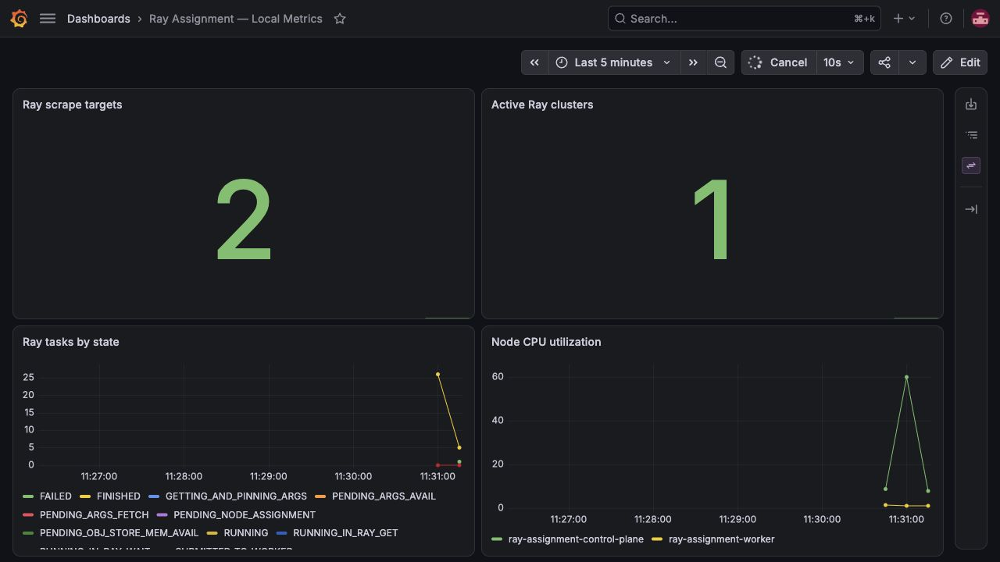
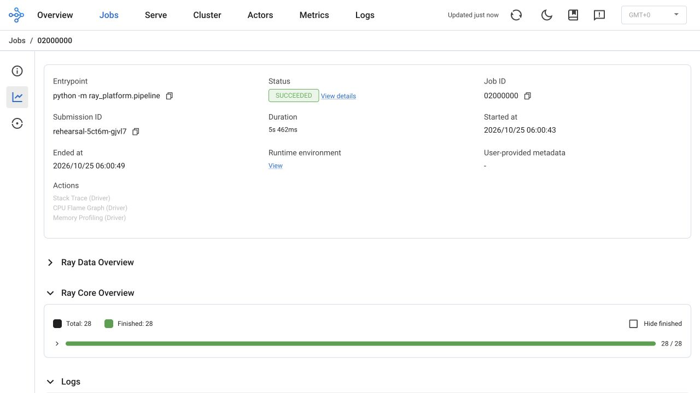
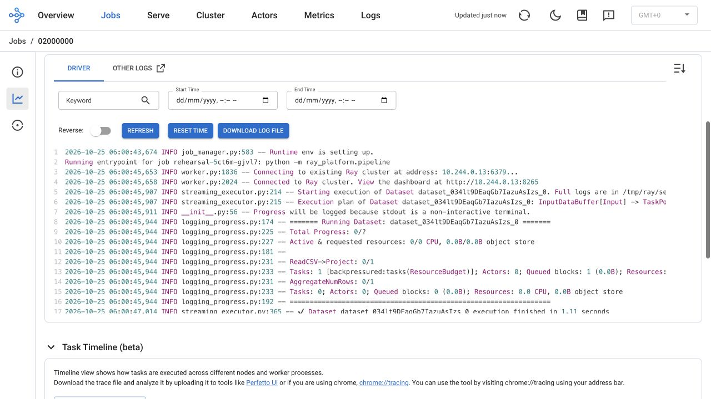
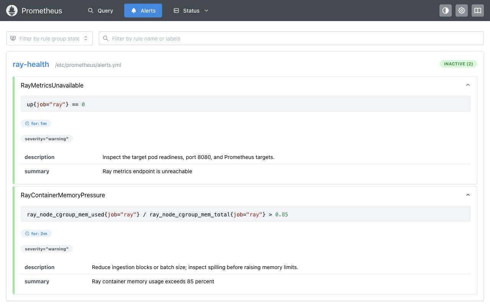

# Final submission: local observability rehearsal

Captured on 25 October 2026 on the local `kind-ray-assignment` cluster. No AWS resources were created for this rehearsal.

## Walkthrough and screenshots

1. **Metrics:** explain that Prometheus scrapes the Ray head and worker and Grafana shows task activity and CPU. The screenshot contains two targets and one retained cluster. Grafana uses the browser timezone (Asia/Kolkata); the Ray timestamps below are UTC. Metrics are sampled, so graph counts are not a final job task ledger.

2. **Execution:** show job `02000000`, submission `rehearsal-5ct6m-gjvl7`, entrypoint `python -m ray_platform.pipeline`, and **SUCCEEDED**. The dashboard records start at 06:00:43 UTC and completion at 06:00:49 UTC, duration 5.462 seconds. Task counts are a point-in-time dashboard observation and can update asynchronously.

3. **Logs:** correlate the same submission ID with driver startup, Ray connection and dataset execution. These are real local driver logs, not CloudWatch delivery evidence. Long lines are horizontally clipped by the native viewer. Credentials and raw runtime files are excluded from this submission.

4. **Alerts:** show both loaded rules and their remediation descriptions: endpoint unreachable for one minute and memory above 85% for two minutes. Both are inactive in this normal-operation capture. The separately saved [successful test output](alert-test-output.txt) comes from `bash scripts/test-monitoring-alerts.sh`; [fixtures](../../../tests/alerts.test.yml) exercise pending, firing, recovery and idle behavior. No live outage or notification delivery is claimed.

## Why the first rehearsal appeared missing

`rehearsal-wj5gj` remained present but was `ValidationFailed`: KubeRay rejects a completion TTL when `shutdownAfterJobFinishes` is false. It never created execution pods. The temporary rehearsal manifest was corrected by removing `ttlSecondsAfterFinished`, while retaining the cluster for screenshots. The replacement `rehearsal-5ct6m` reached `SUCCEEDED` / `Complete`. Both rehearsal RayJobs were explicitly deleted after capture; their Ray clusters and pods were removed. Existing monitoring and unrelated workloads were left intact. The Ray dashboard for this deleted cluster is consequently no longer live.

For a future retained-dashboard capture, remove the completion TTL when setting `shutdownAfterJobFinishes: false`, use a bounded job deadline, and explicitly delete the rehearsal RayJob after capture. Normal submissions should retain their existing automatic cleanup settings.

## Limitations to explain to the reviewer

- This is a functional local demonstration, not a production certification or a new AWS execution. Previous cloud validation is documented separately in [the walkthrough](../../observability-demo.md). No fresh AWS billing total was verified during this rehearsal; the $30 cap still applies.
- No ALB, public endpoint, domain or public TLS certificate was provisioned. Authenticated dashboards use loopback-only port forwards. Remote production access needs approved networking and TLS.
- Prometheus storage is ephemeral with short retention; there is no HA monitoring or durable centralized local logging. Ray's embedded Grafana panels are not configured; the standalone Grafana dashboard works.
- Prometheus evaluates rules, but Alertmanager and external notification receivers are not configured. Fixture tests prove rule behavior, not paging or email delivery.
- The repository remains public on the free plan. Never commit secrets, Terraform state or raw private runtime files. Peer approval is temporarily paused and its restoration policy is documented; CI gates do not replace independent review.
- The container is a tested demo candidate, not an approved golden image: vulnerability findings remain. Production rollout also requires applying and validating the prepared cloud hardening and resolving the temporary HTTPS egress exception.

Use the [8–10 minute walkthrough](../../observability-demo.md) for narration and this folder as the offline evidence fallback.
