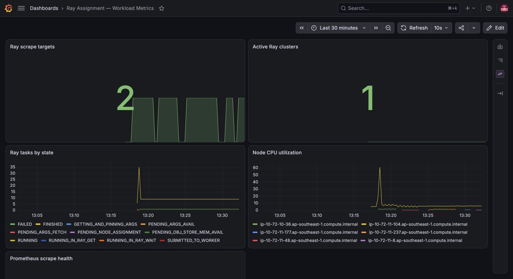
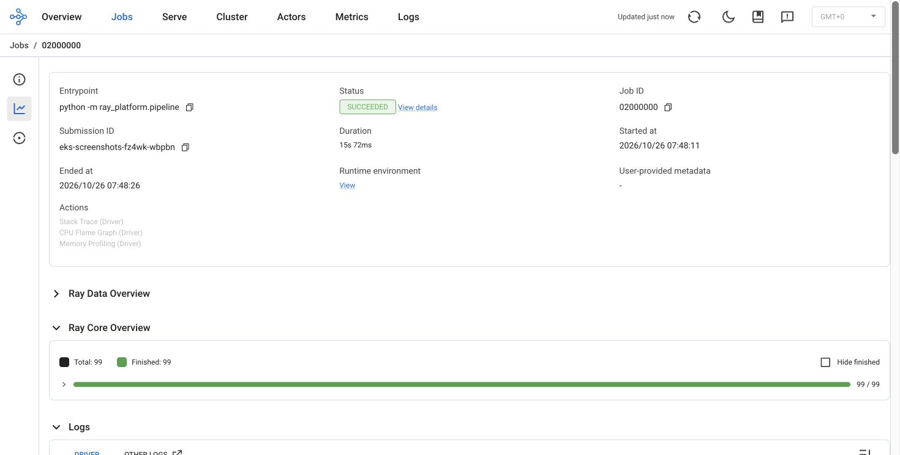
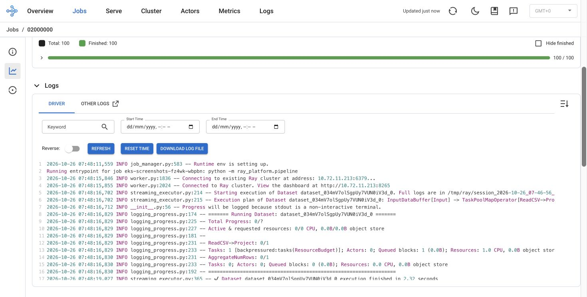
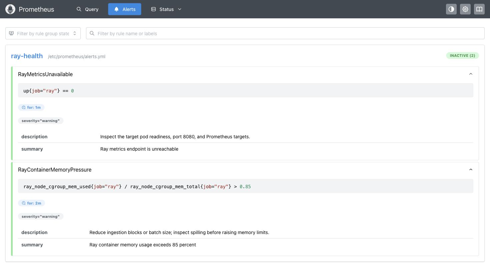

# Ray AI Platform assignment submission

Prepared by Sumit Sharma for the DevOps and Platform Engineering assignment.

The implementation runs a corporate data pipeline on Kubernetes using Ray Data,
a dedicated EntityResolver actor, transactional Apache Iceberg updates and CPU
revenue-model training. The repository includes separate Terraform state layers,
EKS and KubeRay, scoped workload identity, OIDC delivery, monitoring and centralized
AWS logs. Evidence distinguishes completed cloud tests, the local rehearsal and
prepared changes that have not yet been validated in AWS.

Repository: https://github.com/SumitSharma-DevOps-3107/contexq-assignment
Review branch: codex/security-hardening
Pull request: https://github.com/SumitSharma-DevOps-3107/contexq-assignment/pull/2

## Requirement review

The assignment permits amendments to its skeleton. The executable is
`python -m ray_platform.pipeline`; the implementation replaces the simulated
LLM/hash resolver with deterministic identity keys. No LLM credential or GPU is
needed for this synthetic fixture. It does not claim real-world fuzzy matching.

| Assignment requirement | Implementation and evidence | Qualification |
|---|---|---|
| Two CSV datasets with at least 1000 rows each | datasets.py creates 1200 rows per source; 2400 input rows produce 1800 companies | Synthetic fixture |
| Resolve entities and transactionally update Iceberg | SHA-256 identity from country and normalized registration ID; real catalog commit and repeat/update tests | Single writer; not a distributed join |
| Revenue prediction from harmonized data | Training reads committed table; RandomForest uses 1440 training and 360 held-out companies | Synthetic accuracy; CPU driver training |
| Decoupled Terraform layers and managed Kubernetes | bootstrap, data, compute, platform and ci states; EKS module | Private access required for platform |
| Buckets and Iceberg catalog | S3 and Glue; cloud-validation-summary.json | Existing versions require separate encryption migration |
| KubeRay and separate node pools | On-Demand system pool and autoscaled Spot worker pool | One system node is not HA |
| Spot cost and resilience strategy | FIS interruption terminated one worker; actor recovered elsewhere; idempotent rerun | Head failure and distributed training checkpointing not tested |
| Ray Data and Train configuration explanation | README and scaling-and-alternatives.md cover resources, object stores, shared memory and distributed trainer configuration | Distributed Ray Train is design-only |
| EntityResolver placement | Ray custom resource plus pool labels and worker taint; placement evidence | Worker capacity required |
| Workload identity and access boundaries | Driver/actor IRSA verified; state-bucket access denied | Least privilege demonstrated, not a complete zero-trust certification |
| PR Terraform plan | OIDC and private CodeBuild; successful historic PR plan | Cloud CI deliberately paused between demo windows |
| Merge image build and RayJob execution | Successful recorded merged release, ECR digest and RayJob cleanup | New golden-image gate still blocks vulnerable candidates |
| Prometheus metrics | Head/worker, task, CPU and active-cluster families verified | Ephemeral short retention |
| Secure Ray Dashboard | Loopback forwarding and token authentication; unauthenticated request returned 401 | No public ingress |
| Centralized head and worker logs | Fluent Bit and scoped IRSA to CloudWatch; observability-validation.json | Ray UI capture shows driver logs; separate CloudWatch API evidence |
| Repository, setup, diagram and serverless alternative | README, infra documentation, diagram and managed alternative below | Final review branch must be included in handoff |

## Architecture

Cloud data path: S3 CSV inputs → Ray Data workers → EntityResolver actor → driver
harmonization → Iceberg table in S3 with Glue catalog → model and metrics in S3.
The head advertises zero task CPUs; the actor requests the entity_resolver custom
resource available only on the worker group. Kubernetes labels and taints enforce
physical separation. The local equivalent uses a SQLite catalog and filesystem
warehouse solely for reproducibility.

Delivery path: GitHub Actions → repository-scoped OIDC → ECR image build and
private CodeBuild → EKS RayJob. PR plans do not apply infrastructure. The platform
layer owns KubeRay, autoscaling and collectors; application pods use scoped IRSA,
separate from the provisioning role. Prometheus feeds Grafana; Fluent Bit sends
head and worker stdout/stderr to CloudWatch. Dashboards remain private.

## Local setup

Prerequisites: Docker Desktop, Python 3.11, kind, kubectl, Helm, make and Git.
The tested ARM64 Mac has 16 GiB RAM; Docker is allocated 6 CPUs and about 8 GiB.
Use synthetic data only. A fresh machine needs internet access for pinned tools,
images and Python dependencies.

```sh
git clone https://github.com/SumitSharma-DevOps-3107/contexq-assignment.git
cd contexq-assignment
git checkout codex/security-hardening
bash scripts/install-kubectl.sh
export PATH="$PWD/.tools:$PATH"
make preflight
make setup
make test
make run
make image-offline
make local-up
make submit
make status
```

Inspect RayJob status and logs using the explicit kind-ray-assignment context.
Outputs persist under runtime/kubernetes across Ray cluster lifecycles. Submit a
second job after completion: inserts and updates should both be zero and the
Iceberg snapshot should remain unchanged. `make local-down` removes only the
named kind cluster and preserves outputs.

For Grafana run `bash scripts/grafana-local.sh`; use localhost port 3000 and the
private runtime password file. Never publish credentials or raw runtime files.
The screenshot rehearsal retained its Ray cluster temporarily by removing TTL
when shutdownAfterJobFinishes was false, then explicitly removed both test jobs.
Normal jobs keep automatic cleanup. Run `bash scripts/test-monitoring-alerts.sh`
to validate alert pending, firing and recovery against deterministic fixtures.

## AWS setup and teardown

Use Singapore ap-southeast-1 with the authorized assignment profile. Authentication
is browser login followed by role assumption; no static keys are stored in Git.
The reproducible private-access and screenshot procedure is in docs/eks-walkthrough.md.
Source scripts/aws-env.sh, verify account identity and gross spend, and generate
ignored configuration with scripts/aws-configure-project.py. Set an explicit
bounded lease; configuration generation does not silently extend an old deadline.

Apply reviewed plans in dependency order: bootstrap, data, compute, then platform
from private connectivity. Initialize each remote layer with its backend.hcl.
The ci layer requires compute and data outputs. Current source uses private-only
EKS access and customer-managed encryption keys. The earlier /32 public API setup
is historical and must not be copied into a new deployment. Use an authenticated
private path and retain TLS certificate verification.

Upload generated CSVs to the private data bucket input prefix. Use an immutable
ECR digest with scripts/render-aws-job.py and submit through the private API.
Verify SUCCEEDED, S3 artifacts, Glue table metadata, workload identity, the denied
state-bucket read, and repeat-run idempotence. Confirm Prometheus targets and
CloudWatch streams for both node types. Do not enable cloud CI until its settings,
network path, image policy, budget and lease checks all pass.

Destroy platform while the API is reachable, followed by compute and any dependent
CI networking resources in the documented order. Confirm node groups, cluster,
NAT and EIP are gone. Retain state, evidence and storage keys while encrypted data
or versions need them. The lease guard is a fallback; delayed billing and async
cleanup mean it is not a hard dollar cap.

## Module and delivery design

infra/modules/eks contains separate variables, locals, outputs and version
constraints, validated node-pool inputs, dynamic worker taints and instance/volume
tags. The stable system/worker resource addresses avoid needless state moves.
The root pins provider versions and lock files; the reusable module declares a
compatible version range. Its VERSION and CHANGELOG describe 1.0.0-rc.1; no remote
release tag is claimed. Pin a reviewed commit for Git consumption.

Security checks include source and resolved-plan scanning, secret scanning,
conventional PR titles, local hooks and required CI. Peer approval is temporarily
paused at the owner's request; restoration policy is retained. The public GitHub
Free repository contains sanitized evidence only. Atlantis is a plan-only
configuration, not a live webhook service. These distinctions are intentional.

## EKS validation

On 26 October 2026, the refactored module provisioned EKS 1.34 in Singapore
with a private-only API and KMS secrets encryption. Both managed node pools
became Ready. Operator access used Systems Manager and a loopback CONNECT
bridge with the original hostname and CA verification. No ALB, domain or public
ingress was created. The bounded lease expires at 09:19:05 UTC that day.

RayJob eks-screenshots-fz4wk succeeded. Its Ray submission
eks-screenshots-fz4wk-wbpbn completed at 07:48:26 UTC in 15.072 seconds.
The pipeline read 2400 S3 input rows and produced 1800 companies against the
existing Glue/Iceberg table, with zero inserts and zero updates on this repeat
run. Driver and worker identities both used the scoped pipeline IRSA role.
Prometheus verified two healthy Ray targets. Fresh CloudWatch events from both
ray-head and ray-worker were collected for this run. Unauthenticated Grafana and
Ray API requests both returned HTTP 401. Alert fixture tests passed inside EKS.

The run used the previously tested immutable ECR digest ending in
0c16a242adeb4. This was a manual evidence execution, not golden-image promotion
or a rerun of paused cloud CI. Earlier checks verified SSE-KMS state writes and
data-bucket defaults. Existing object versions and CI artifact encryption were
not migrated in this run. Machine-readable evidence is in
 docs/evidence/eks-rehearsal/final-capture-run.json.

At 13:34 UTC on 26 October, AWS confirmed the EKS cluster absent, with no
assignment EC2 instances, active NAT gateways or allocated Elastic IPs in Singapore.
Retained storage, encryption keys and CloudWatch logs remain. Out-of-band compute
cleanup requires Terraform refresh and reconciliation before the next deployment.

## Demonstration evidence

These four screenshots show the actual EKS environment on 26 October 2026,
accessed through localhost tunnels. The separate local rehearsal remains in
docs/evidence/rehearsal. Full-resolution cloud captures are in
docs/evidence/eks-rehearsal.



Two scrape targets and one retained Ray cluster. Grafana uses Asia/Kolkata time.
The gaps show worker turnover during the retained demonstration window.



Submission eks-screenshots-fz4wk-wbpbn succeeded in 15.072 seconds. Ray timestamps
are UTC. The retained cluster continued reporting task counters after completion.



The same submission appears in the driver logs. Long lines are clipped by the
native viewer; this screenshot is not a full archive or a CloudWatch UI capture.



Both rules are inactive during normal operation. Saved promtool fixtures verify
pending, firing and recovery. No Alertmanager or external notification delivery
is claimed.

## Known limitations and production work

The implementation is a working assignment with explicit production gaps:
single system node and NAT, bounded worker capacity, ephemeral Prometheus storage,
short CloudWatch retention, no external paging, no public domain/certificate and
no HA monitoring. Localhost tunnels provide the demonstration access path.
Ray's embedded Grafana panels are not wired; standalone Grafana works.
The retained screenshot cluster showed repeated idle worker turnover and scrape
gaps after job completion. Autoscaler interaction needs investigation and tuning
before using long-lived Ray clusters in production.

Driver materialization is capped at 100000 rows. Larger inputs need partitioned
Parquet, streaming transformations and distributed joins. Distributed Ray Train
needs a simultaneous worker group, framework configuration and durable training
checkpoints. The tested CPU baseline restarts training after failure. Entity
resolution assumes valid registration identifiers and one record per company per
source. Multi-writer conflict handling, GPU workloads and real LLM integration
are outside the demonstrated fixture.

The newer local image candidate has 50 HIGH findings in the recorded OS/Python
scan, excludes Java archives, and is not golden eligible. It was not pushed to
ECR. Historic release success is not proof that a current vulnerable image passes
the added gate. Remediation and a complete approved scan are required before a
production release. The narrowly scoped HTTPS egress exception is temporary and
expires on 1 November 2026; it is not domain-based outbound control.

The total AWS ceiling is USD 30 before credits. Posted gross spend was USD 4.18
at the post-cleanup check on 26 October; usage is delayed and this is not the final bill. KMS and retained storage can continue to incur cost after compute
cleanup. Budget alerts and lease checks supplement manual verification.

## Managed alternative

EventBridge Scheduler → Step Functions → Glue Spark ingestion and Iceberg updates
→ an ECS Fargate task for CPU sklearn training → S3 model artifacts removes EKS
and node/operator management. Use scoped roles per stage and bounded retries.
This requires adapting the Ray APIs and is a documented alternative, not a deployed
or measured cheaper solution. Larger distributed/GPU training could use an
on-demand SageMaker training job instead of the Fargate stage.

## Validation record and handoff

At the module review checkpoint, 49 pytest tests passed. On commit cd603ad,
PR checks validate, security and pr-title passed; cloud-plan was intentionally
skipped. Later module/evidence changes require their own final CI check. Historic
successful AWS runs include main/PR planning and merged release execution; links
are in docs/cicd-validation.md. The submission must include this review branch,
the final document and sanitized evidence; it should not imply PR merge or a
production deployment has occurred.
